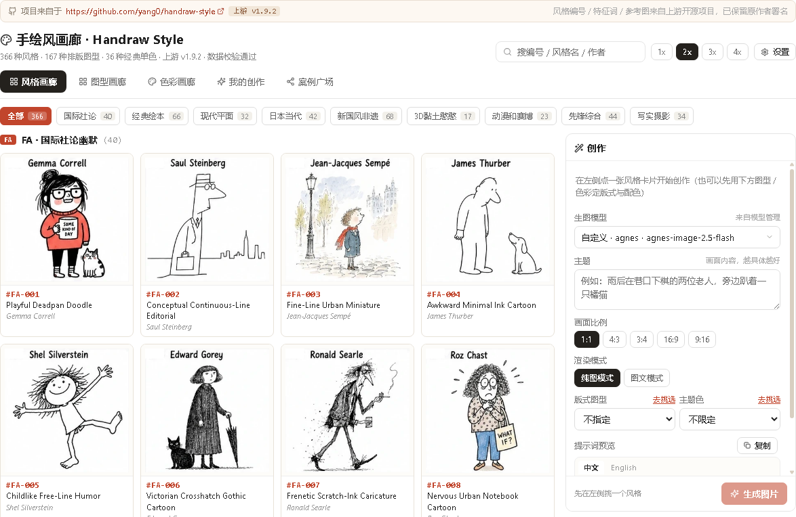
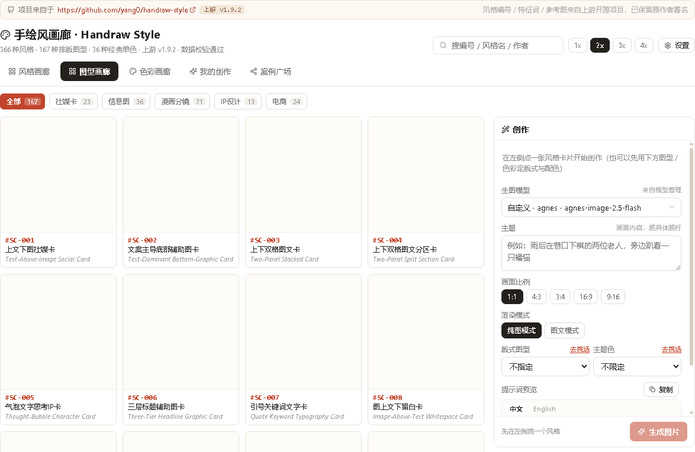
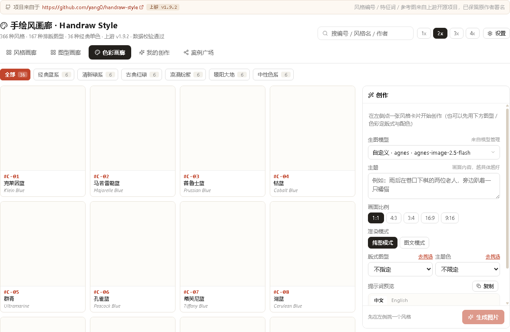
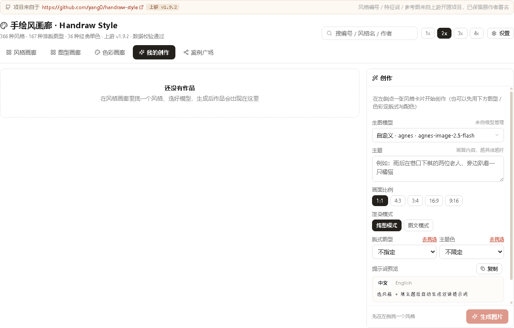

# 手绘风画廊（366 种风格 × 167 种图型 × 36 款单色）

> 想让 AI 画一张"手绘风"的图，最难的不是模型，是**说清楚你要哪种手绘**：是铅笔速写还是蜡笔涂鸦？是水彩晕染还是版画刀刻？凭感觉写提示词，十张里能中一张就不错。
>
> 手绘风画廊把这件事变成**看图选编号**：366 种手绘风格、167 种排版图型、36 款经典单色，按九大类铺成缩略图画廊。点卡片看编号与特征词，右侧选模型直接出图，提示词自动组装好——中文给你看，英文给模型读。

**📦 一键安装**：[https://ruodao.com/plugin-market/items/handraw-style](https://ruodao.com/plugin-market/items/handraw-style)（若道桌面端「功能插件市场」搜索"手绘"，或市场页直接「下载 ZIP」用本地安装导入。）

---

## 💎 四个理由

### 🖼️ 1. 选风格像逛画廊，不用背提示词

九大类缩略图平铺：点开一张就知道是你要的味道。每张卡片带**风格编号与特征词**（线条、材质、配色、笔触），不用懂提示词工程，看得懂图就会用。

### 🧩 2. 风格 × 图型 × 单色，三轴自由组合

366 种风格定"画成什么样"，167 种图型定"画成什么结构"（信息图、绘本页、分镜、海报、知识卡……），36 款单色定"用什么调子"。三轴组合出几十万种搭配，且每个组合都能复现。

### 🌏 3. 中英双语提示词自动组装

中文给你看（确认选对了风格），英文给模型读（模型更认）。`组装提示词` 命令接 `{ styleCode, theme, layoutCode?, colorCode? }`，直接给出成稿提示词。

### 🔒 4. 作品与提示词全在本机，不存任何 Key

生成记录、图片、提示词都落在本机；插件**不保存任何 API Key**，模型凭据由若道宿主注入。插件本身只申请 `network` 一项权限。

## 🖼️ 界面预览

| 风格画廊（366 种） | 图型画廊（167 种） |
| --- | --- |
| [](docs/screenshots/1.png) | [](docs/screenshots/2.png) |

| 色彩画廊（36 款单色） | 我的创作 |
| --- | --- |
| [](docs/screenshots/3.png) | [](docs/screenshots/4.png) |

## ✨ 功能总览

| 命令 | 说明 |
| --- | --- |
| `自检` | 检查风格库数据文件、分组数量与参考图基址，返回 366 风格 / 167 图型 / 36 单色的实际条数 |
| `读取风格库` | `{ section: "meta"\|"styles"\|"layouts"\|"colors"\|"all", group? }` |
| `组装提示词` | `{ styleCode, theme, layoutCode?, colorCode? }` → 中英双语提示词 |

工作台里还能：点卡片直接选模型出图、成图一键分享到插件案例、按分类筛选、搜索特征词。

## 📥 安装

1. 下载并安装 [若道桌面端](https://ruodao.com)。
2. 「功能插件市场」→ 搜索 **手绘** → 安装。
3. 侧边栏打开「手绘风画廊」，先在「模型管理」里配好一个图像模型，然后在画廊右侧选模型。

## 🚀 使用教程

1. **挑风格**：风格画廊按九大类浏览，点卡片看编号与特征词；
2. **挑结构**（可选）：图型画廊选一个版式，比如「信息图三栏」「绘本跨页」；
3. **挑色调**（可选）：色彩画廊选一款单色；
4. **写主题**：一句话说清画什么（"给小学生讲光合作用"）；
5. **出图**：右侧选模型 → 生成 → 成图进「我的创作」，提示词同时留档，下次可复用。

## 🛠️ 二次开发

```
├── plugin.json           # 元信息
├── ruodao-plugin.json    # 核心：id、权限（network）、3 个命令
├── ui.json               # 工作台界面
├── bin/handraw.mjs       # 命令入口（自检 / 读取风格库 / 组装提示词）
├── lib/prompt.mjs        # 提示词组装（中英双语）
├── data/styles.json      # 366 种风格
├── data/layouts.json     # 167 种图型
├── data/colors.json      # 36 款单色
├── test/plugin.test.mjs  # 测试
└── docs/screenshots/     # 本页截图
```

**加一种风格**：在 `data/styles.json` 里按现有结构加一条（编号、分类、中英特征词、参考图），工作台会自动多一张卡片。

```bash
node --test test/
```

## 📦 更新日志

- **v1.0.1**（当前开源版本）：366 风格 / 167 图型 / 36 单色画廊、中英双语提示词组装、成图分享。

## 🔗 相关

- 插件市场页：[https://ruodao.com/plugin-market/items/handraw-style](https://ruodao.com/plugin-market/items/handraw-style)
- 若道官网：[https://ruodao.com](https://ruodao.com)
- 更多插件源码：[https://github.com/ruodaoai](https://github.com/ruodaoai)

## License

MIT
